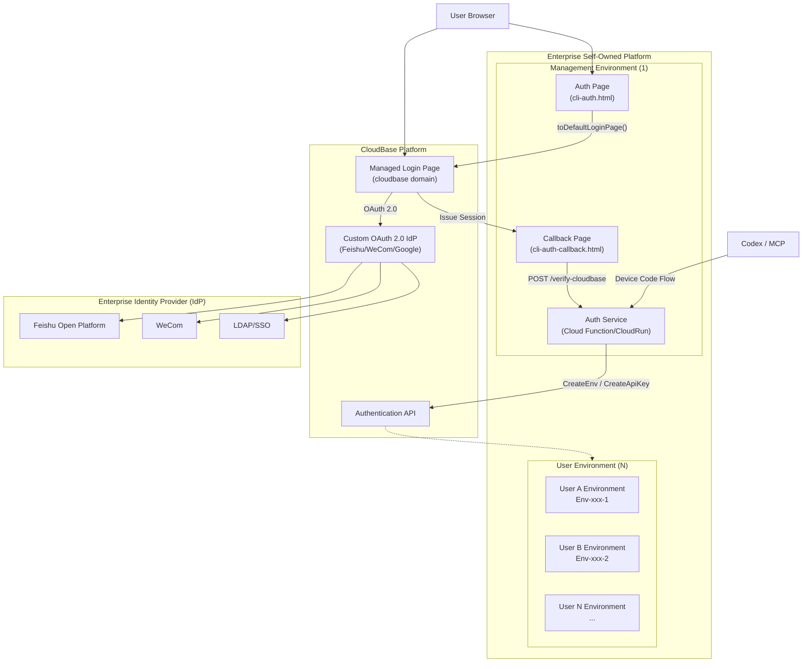
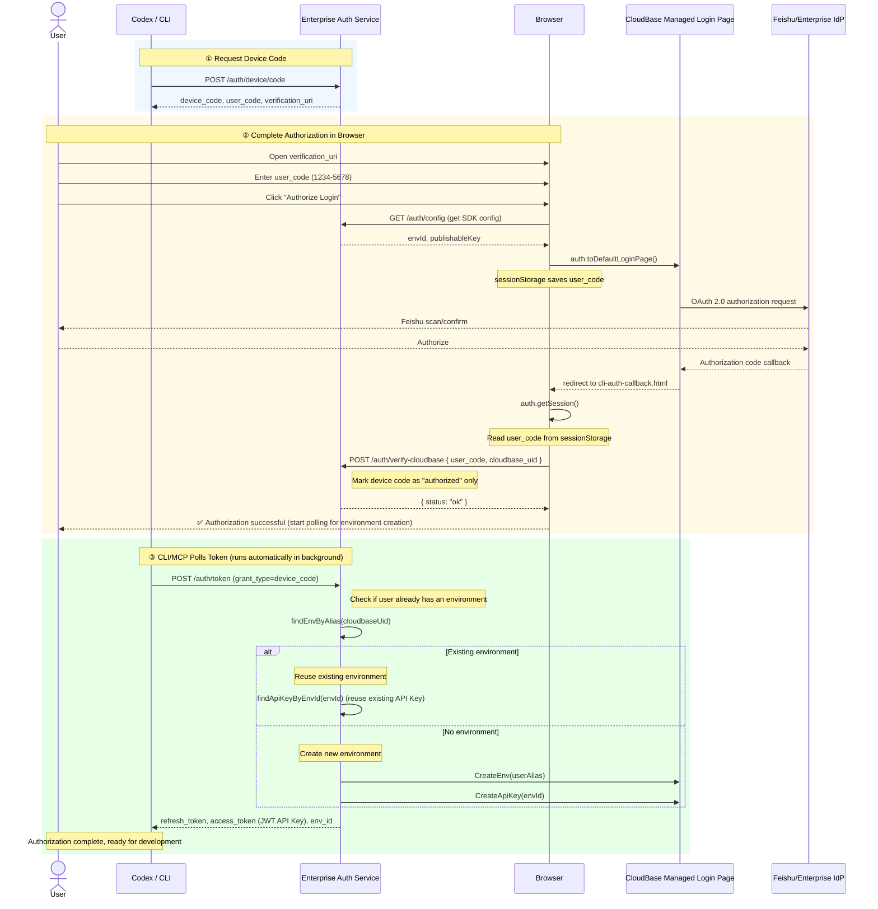
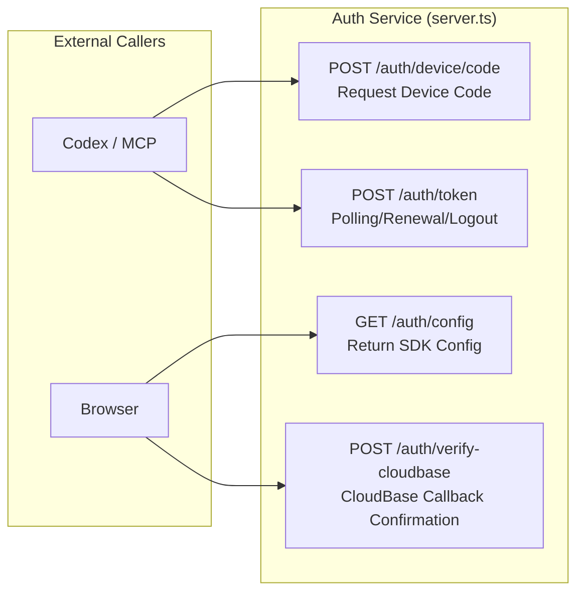

# Enterprise Branded AI Platform Integration Guide — Feishu/WeCom SSO Integration

> Reference code: [`examples/cloudbase-auth-endpoint-with-feishu/`](https://github.com/TencentCloudBase/CloudBase-MCP/tree/main/examples/cloudbase-auth-endpoint-with-feishu) + CloudBase Managed Login Page + Custom OAuth 2.0 Identity Provider

---

## 1. Background

When enterprise AI platforms (such as Coding Agent, MCP toolkits, etc.) need to integrate with existing customer account systems, they face two key challenges:

1. **Users are unaware of Tencent Cloud**: Authentication must be completed under the enterprise's own domain
2. **Integration with enterprise IdP**: Users want to log in with existing accounts such as Feishu (Lark)/WeCom/LDAP

CloudBase provides a **Managed Login Page + Custom OAuth 2.0 IdP** solution. Enterprises only need to configure the IdP in the Console, without having to implement complex logic like Feishu OAuth callbacks, token exchange, or user info retrieval.

See the reference code at [`examples/cloudbase-auth-endpoint-with-feishu/`](https://github.com/TencentCloudBase/CloudBase-MCP/tree/main/examples/cloudbase-auth-endpoint-with-feishu), which works with the CloudBase Managed Login Page to deliver a complete enterprise-branded authorization flow.

---

## 2. Overall Architecture (1+N)



**Architecture Overview**:

- **1 Management Environment**: Deploys the Auth Service (including device code API + auth page + callback page), configures custom OAuth 2.0 IdP in the CloudBase Console
- **N User Environments**: Each user gets an independent environment automatically created upon successful authentication, with API Key issued. Resources are fully isolated between environments
- **CloudBase Managed Login Page**: A unified SSO entry point that displays all configured IdPs and handles backend OAuth callbacks

---

## 3. Prerequisites

### 3.1 CloudBase Environment

| Resource | Description |
|----------|-------------|
| Management Environment | 1 CloudBase environment for deploying the Auth Service |
| Publishable Key | Obtain from Console "Authentication → App Management" |
| **Tencent Cloud API Key** | Obtain from Console "Access Management → API Key Management" (requires `tcb:CreateEnv` + `tcb:DescribeEnvs` + `tcb:CreateApiKey` permissions). Note that `CreateEnv` is a billable operation. **For production deployment, it is recommended to use a sub-account key** with scoped resource limits to avoid abuse and financial loss |

### 3.2 Enterprise Identity Provider

Taking Feishu as an example, you need to create an enterprise self-built app on the Feishu Open Platform:

| Configuration Item | Description |
|-------------------|-------------|
| App ID | Feishu app unique identifier |
| App Secret | Feishu app secret |
| Authorization Redirect URL | Enter the Managed Login Page callback URL provided by the CloudBase Console |

> For other OAuth 2.0 identity providers such as WeCom and Google Workspace, the configuration steps are similar, with the difference being the authorization endpoints on the IdP side.

### 3.3 CloudBase Console Configuration

1. Log in to the [CloudBase Console](https://tcb.cloud.tencent.com/dev) and enter the Management Environment
2. Left menu → **Authentication → Enterprise Identity Provider**
3. Add a custom OAuth 2.0 Identity Provider:
   - Name: e.g. "Feishu (Lark)"
   - Authorization Endpoint: Feishu OAuth authorization URL
   - Token Endpoint: Feishu OAuth Token URL
   - Client ID: Feishu App ID
   - Client Secret: Feishu App Secret
   - Callback URL: Copy the address provided by the Console and enter it in the Feishu Open Platform
4. Go to **Authentication → Managed Login Page**, select the IdP you just configured, and save

> Configure once in the Console; all subsequent applications will inherit it automatically without any code changes.

---

## 4. Deploying the Auth Service

### 4.1 Clone the Example Code

```bash
# Clone the repository from GitHub
git clone https://github.com/TencentCloudBase/CloudBase-MCP.git
cd CloudBase-MCP/examples/cloudbase-auth-endpoint-with-feishu
npm install
```

### 4.2 Configure Environment Variables

```bash
cp .env.example .env
```

Edit the `.env` file:

```env
# Service port (SCF HTTP function is fixed at 9000)
PORT=9000
# Auth Service base URL (replace with the actual gateway URL after deployment)
BASE_URL=https://{your-gateway-domain}/{path-prefix}

# CloudBase Management Environment
CLOUDBASE_ENV_ID=your-management-env-id
CLOUDBASE_PUBLISHABLE_KEY=your-publishable-key
CLOUDBASE_REGION=ap-shanghai

# Tencent Cloud API Key (for creating user environments + issuing API Keys)
TENCENTCLOUD_SECRET_ID=your-secret-id
TENCENTCLOUD_SECRET_KEY=your-secret-key
```

### 4.3 Local Development

```bash
npm run dev
```

### 4.4 Deploy to CloudBase

It is recommended to configure CloudBase MCP in your AI development tool and then let the AI complete the deployment through natural language.

**Prerequisite**: Ensure CloudBase MCP is enabled in your AI development tool (see [Configuration Guide](https://docs.cloudbase.net/ai/cloudbase-ai-toolkit/ide-setup/codebuddy)).

**Database Collection Setup**: The Auth Service uses CloudBase NoSQL document database to store device code and token records. During deployment, tell the AI "create the auth_devices and auth_refresh_tokens collections", and the MCP will create them automatically:

| Collection Name | Purpose |
|-----------------|---------|
| `auth_devices` | Stores device code records and user-environment-API Key associations |
| `auth_refresh_tokens` | Stores refresh tokens for token renewal and logout |

Enter the following in the AI conversation:

> Please deploy the `examples/cloudbase-auth-endpoint-with-feishu` directory as an SCF HTTP function with function name `auth-service`, runtime Nodejs18.15, timeout 120 seconds, and read environment variables from the `.env` file. After deployment, add a gateway route pointing to this function.

The AI will automatically use MCP tools to complete the following:

1. **Create Cloud Function**: Call `manageFunctions` to upload code, install dependencies, and configure environment variables
2. **Configure Gateway**: Call `manageGateway` to create an HTTP access entry for the Cloud Function
3. **Return Access URL**: Return the gateway URL after deployment is complete

**Important Notes**:
- Do not use `domain: "*"` as a wildcard domain for the gateway route, as it will intercept CloudBase's built-in `__auth/` Managed Login Page
- **The gateway `path` parameter is directly related to `TCB_AUTH_OAUTH_ENDPOINT`**: The `path` specified when creating the HTTP access entry is the path prefix used in subsequent configuration. For example, when `path=/auth`, the endpoint is `https://{gateway-domain}/auth`; the toolkit automatically appends sub-paths like `/device/code`, `/token`, etc. If the path is modified, the `TCB_AUTH_OAUTH_ENDPOINT` environment variable must be updated accordingly
- After the initial deployment, you can bind your own domain (e.g. `auth.your-company.com`)
- For subsequent code updates, simply ask the AI to call `updateFunctionCode`

### 4.5 Verify the Service

```bash
# Test the device code request endpoint (replace {base-url} with the actual gateway URL)
curl -X POST https://{base-url}/auth/device/code \
  -H 'Content-Type: application/json' \
  -d '{}'

# Response example
{
  "device_code": "a1b2c3d4...",
  "user_code": "1234-5678",
  "verification_uri": "https://{base-url}/cli-auth.html",
  "expires_in": 600,
  "interval": 3
}
```

---

## 5. Integrating with Codex

### 5.1 Method 1: Quick Integration via MCP Plugin (Recommended)

After installing the CloudBase MCP plugin in Codex (see [Installation Guide](https://docs.cloudbase.net/ai/cloudbase-ai-toolkit/ai-agent-plugins)), simply enter the following in the conversation:

```
Use CloudBase, SSO authorization address is https://{your-gateway-domain}/{path-prefix}
```

The AI will automatically complete the MCP configuration and authorization integration without manually writing environment variables.

### 5.2 Method 2: Manual Environment Variable Configuration

If you prefer manual control, you can also configure MCP environment variables manually in Codex:

```json
{
  "mcp_servers": {
    "cloudbase": {
      "command": "npx",
      "args": ["@cloudbase/cloudbase-mcp@latest"],
      "env": {
        "INTEGRATION_IDE": "Codex",
        "TCB_AUTH_OAUTH_ENDPOINT": "https://{your-gateway-domain}/{path-prefix}"
      }
    }
  }
}
```

> **About the `TCB_AUTH_OAUTH_ENDPOINT` value**: It is determined by the `path` parameter when creating the HTTP access entry in the gateway. For example, if the gateway path is set to `/auth`, the endpoint is `https://{gateway-domain}/auth`. This value matches the gateway path prefix, and the toolkit internally appends sub-paths such as `/device/code`, `/token`, etc.

**Optional Configuration Items:**

| Environment Variable | Description | Default Value |
|--------------------|-------------|---------------|
| `TCB_AUTH_CLIENT_ID` | Custom device-code login client_id (advanced, optional) | If not set, the default client_id is used |
| `TCB_AUTH_OAUTH_CUSTOM` | Custom endpoint response format toggle (advanced, optional) | Defaults to `false` when endpoint is not configured; defaults to `true` when endpoint is configured |

### 5.3 Device Code Login

After configuring `TCB_AUTH_OAUTH_ENDPOINT`, Codex will automatically execute the device code authorization flow. The CLI will output the device code and auth page URL:

```
Device confirmation requested. Open the following URL in your browser:
  https://{base-url}/cli-auth.html

Enter the code: 1234-5678
Waiting for authorization...
```

### 5.4 Browser Authorization

Open the auth page, enter the device code, and click "Authorize Login":



### 5.5 Verify Development Capabilities

After successful login, MCP tools in Codex can operate the user environment through natural language:

> **View environment info**: Enter "view current environment info" or "list all environments"
>
> **Deploy Cloud Function**: Enter "deploy a hello-world cloud function for me" or "deploy the function in the current directory to the cloud"
>
> **Operate database**: Enter "query all data in the users collection" or "create a new table in the database"
>
> **Manage storage**: Enter "upload a file to cloud storage" or "list files in the storage bucket"

The AI will automatically invoke the corresponding MCP tools to complete the operations, without needing to manually enter CLI commands.

---

## 6. Key File Descriptions

### 6.1 Server-side Code

| File | Description |
|------|-------------|
| `src/server.ts` | HTTP entry point, defines core endpoints (device code request, CloudBase callback confirmation, Token polling, SDK configuration, etc.) |
| `src/config.ts` | Environment variable loading |
| `src/types.ts` | Device code record, Token record, request body types |
| `src/utils/auth.ts` | CloudBase HTTP API `access_token` ownership validation utility |
| `src/utils/oauth.ts` | Device code/user code generation, OAuth error structures |
| `src/utils/device-store.ts` | Device code record storage (in-memory in the example, database for production) |
| `src/utils/tcb.ts` | CloudBase API calls (CreateEnv/CreateApiKey) |

### 6.2 Frontend Pages

| File | Description |
|------|-------------|
| `public/cli-auth.html` | Auth page: user enters device code, redirects to Managed Login Page |
| `public/cli-auth-callback.html` | Callback page: handles OAuth callback, completes device code authorization |

### 6.3 server.ts Core Endpoints



---

## 7. Extension Directions

| Extension Item | Description |
|---------------|-------------|
| **Persistent Storage** | Replace the in-memory deviceStore / refreshTokenStore with Redis or a database |
| **Permission Scoping** | API Key is issued as `api_key` type (full admin privileges); can be used with `publish_key` (frontend read-only) |
| **Audit Logging** | Record every device code request, authorization, and renewal operation |
| **Rate Limiting** | Add frequency limits to device code request, Token polling, and other endpoints |
| **Multiple IdPs Simultaneously** | Enable Feishu + WeCom + LDAP simultaneously in the Console, allowing users to choose freely |
| **SAML Identity Provider** | Support SAML protocol enterprise identity providers |
| **CI/CD Integration** | Incorporate Auth Service deployment into the CI/CD pipeline |

---

## 8. FAQ

**Q: Do users need a Feishu account?**
A: No. Enterprises can configure any number of identity providers in the CloudBase Console. Feishu, WeCom, LDAP, etc. can all be enabled simultaneously, and users can choose freely on the login page.

**Q: What is the domain of the Managed Login Page?**
A: The Managed Login Page is under the CloudBase domain, but the entry point of the user authorization flow (the auth page) is under the enterprise's own domain, so users are unaware of CloudBase's presence.

**Q: How long does environment creation take?**
A: The CreateEnv operation typically takes 10-30 seconds. During environment creation, the MCP polling of `/auth/token` will continuously return `authorization_pending`, and the credentials will be returned once creation is complete.

**Q: How to handle user deletion/departure?**
A: After disabling the account on the Feishu/IdP side, the next attempt to obtain a new Token will fail authentication. Existing Sessions become invalid after expiration. The Auth Service can be extended with an explicit logout API.

**Q: Does this solution support existing API Key integration methods?**
A: Yes. The solution described above uses the `CreateApiKey` API (see [documentation](https://cloud.tencent.com/document/api/876/129835)) to issue `api_key` type credentials for each user environment. You can also use the `publish_key` type (frontend read-only) instead.
