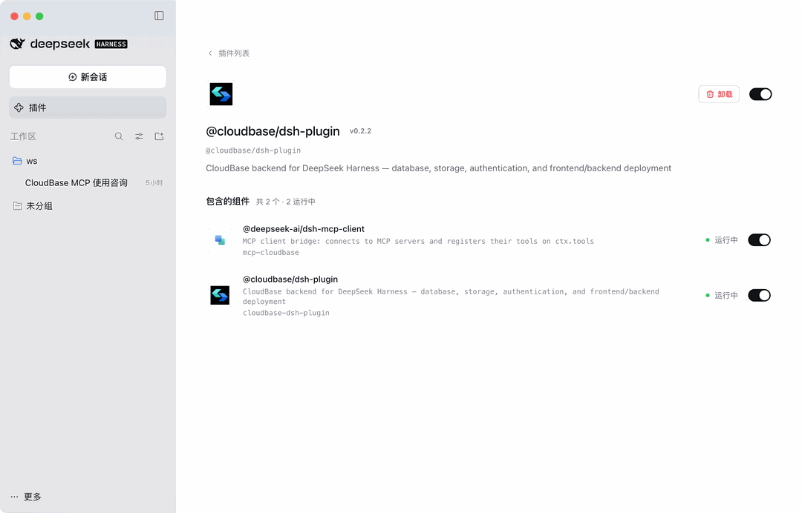

import IDESelector from '../components/IDESelector';
import RelatedResources from '../components/RelatedResources';

# DeepSeek Harness Setup Guide

[DeepSeek Harness](https://github.com/deepseek-ai/deepseek-harness) (DSH) is DeepSeek's desktop agent app. Installing `@cloudbase/dsh-plugin` lets you create tables, upload files and deploy both ends straight from the chat.

Once configured, you can operate CloudBase services directly from the DSH chat.

**For example:**

- "Build a WeChat mini-program ordering system with CloudBase" - AI scaffolds the pages, creates the document database, writes cloud functions and guides you through preview
- "Build a booking system where users place orders and the admin changes status" - AI models it on CloudBase PostgreSQL, configures permissions and wires up both ends
- "Add phone-number sign-in to a web app" - AI enables the auth method and wires in the CloudBase SDK

No switching to the cloud console - everything can be done in DSH with natural language.

## Prerequisites

<details>
<summary><strong>DSH and Node.js</strong></summary>

**DSH version:** compatible with `>=0.1.0-rc.6 <0.3.0` (verified on `0.2.0-rc.2`). Run `dsh --version` to check.

**Node.js:** make sure Node.js v18 or later is installed:

```bash
node --version
```

If it is missing, download it from [nodejs.org](https://nodejs.org/en/download).

**CloudBase environment:** See [Create an environment](../../../quick-start/create-env). New users on the domestic site can activate one for free.

</details>

---

<IDESelector defaultIDE="deepseek-harness" />

## Install

The plugin comes in two forms. Pick the one you need:

| Form | What you get | When to use it |
| --- | --- | --- |
| Web UI | MCP tools plus in-session result tables, deploy previews and other UI | Day-to-day use |
| Headless | MCP tools only, no frontend build | Tool access only, or machines that cannot run the frontend build |

### Web UI (recommended)

The one-shot script handles the install and its dependencies:

```bash
curl -fsSL https://raw.githubusercontent.com/TencentCloudBase/CloudBase-AI-Toolkit/main/dsh-plugin/scripts/install.sh | bash
```

To do it by hand instead, the equivalent steps are:

```bash
dsh plugin --profile web add @cloudbase/dsh-plugin
# pnpm ≥9 blocks dependency install scripts by default (protobufjs fails); the one-shot script already covers this
echo "enable-scripts=true" >> ~/.dsh/profiles/web/.npmrc
(cd ~/.dsh/profiles/web && pnpm install)
dsh --profile web
```

### Headless

When you only need the MCP tools and no UI:

```bash
dsh plugin --profile headless add @cloudbase/dsh-plugin
dsh --profile headless "列出所有 mcp__cloudbase__ 工具"
```

## Using it after install

Open the plugin page in DSH. `@cloudbase/dsh-plugin` is listed with its components showing as **running**. Two components work together:

| Component | Role |
| --- | --- |
| `@deepseek-ai/dsh-mcp-client` | DSH's built-in MCP client bridge, which registers the tools exposed by MCP services |
| `@cloudbase/dsh-plugin` | The CloudBase plugin itself: 31 skills plus the MCP tools |



You sign in once on first use (see the next section); after that, start a new session and just describe what you want.

Write operations (running SQL, uploading files, deleting data) are never executed silently - they come back to the session for your confirmation.

## Sign-in (device code, no API Key)

The plugin forwards no CloudBase environment and no API Key. Sign-in goes through cloudbase-mcp's own device-code flow. If `tcb login` state exists locally, it is reused.

Without sign-in state, tell the model:

```
调用 mcp__cloudbase__auth，action=start_auth，authMode=device，把 verification URL 给我。
```

Authorize once in the browser and the sign-in state persists. Then call `mcp__cloudbase__auth` with `action=set_env` to pick an environment; later tools use it automatically.

> **Note:** Do not configure `CLOUDBASE_API_KEY` for the plugin. An invalid key blocks device-code sign-in, and both sign-in and environment selection go through `mcp__cloudbase__auth`.

## Things to know

1. **Web UI plugins need a DSH frontend rebuild**: if the plugin card is missing from the UI after install, run `pnpm run build:web` from the DSH install directory and restart DSH. Headless does not.
2. **The first package fetch can take 10–90 seconds**: the first headless tool listing may come back empty - retry.
3. **Skills are registered by the plugin**, not copied into `~/.dsh/skills`; bind an environment with `auth` `set_env` and inspect it with `action=status`.
4. **Credentials stay local** (tcb sign-in state or `~/.dsh/.credentials.yaml`, mode 600). The plugin does not upload secrets, and read operations only touch your own CloudBase environment.

## Verify the connection

Type this in the chat:

```
检查 CloudBase 工具是否可用
```

Or ask for something concrete:

```
帮我查一下当前 CloudBase 环境的状态
```

## FAQ

**Q: The CloudBase plugin is missing from the plugin page.**
A: The Web UI form needs a DSH frontend rebuild (see item 1 above), then restart DSH.

**Q: The tool list is empty.**
A: The first install downloads dependencies - wait 10–90 seconds and retry. Make sure Node.js works and the network connection is fine.

**Q: It keeps saying I am not signed in, or sign-in fails.**
A: Check whether `CLOUDBASE_API_KEY` is configured for the plugin. If so, remove it and run the device-code sign-in again.

**Q: The tool count shows 0.**
A: See [FAQ](../faq#mcp-shows-0-tools).

More questions: [full FAQ](../faq)

<RelatedResources ideName="DeepSeek Harness" ideDocUrl="https://github.com/deepseek-ai/deepseek-harness" />
