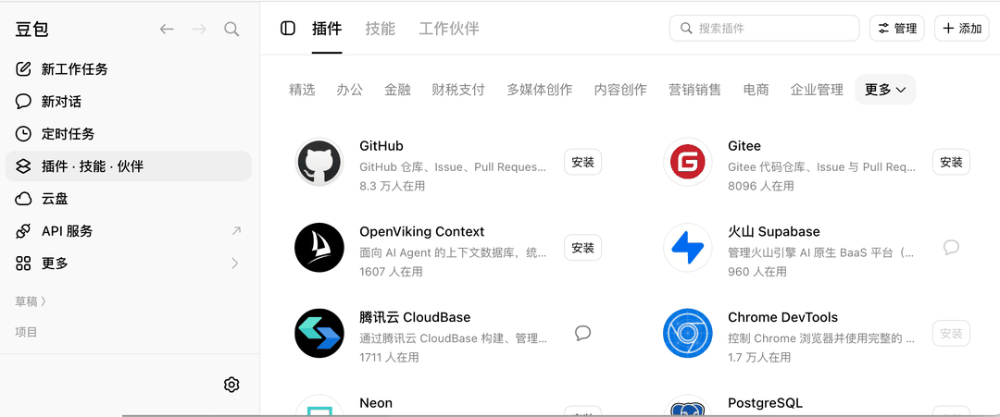
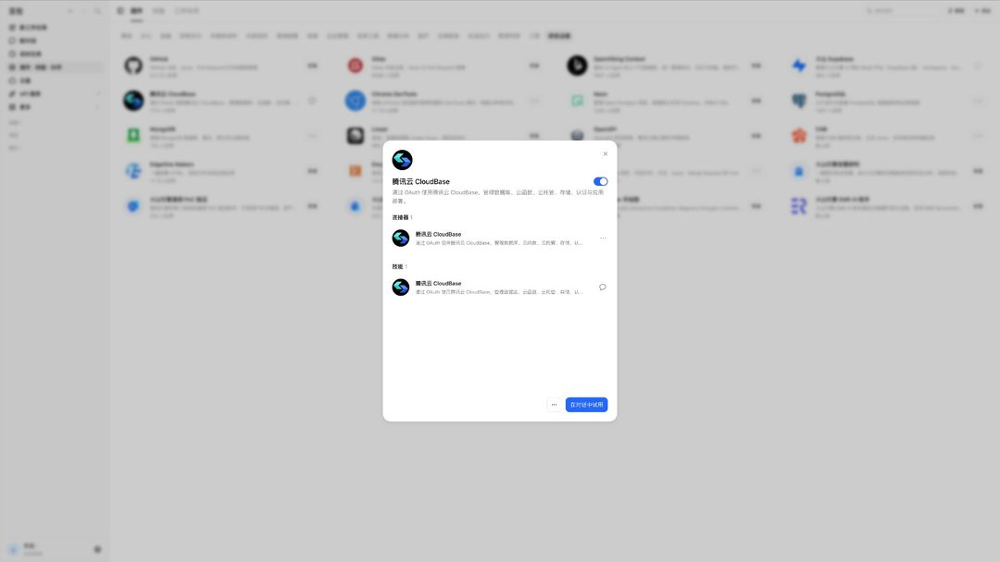
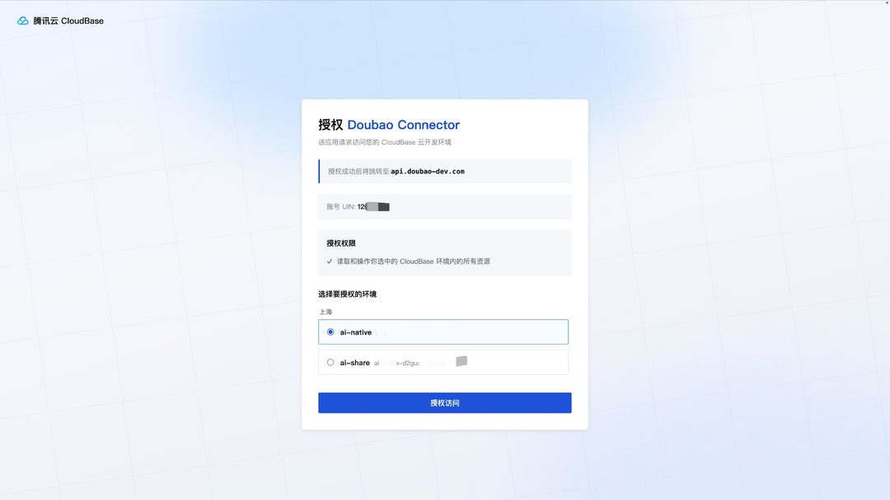
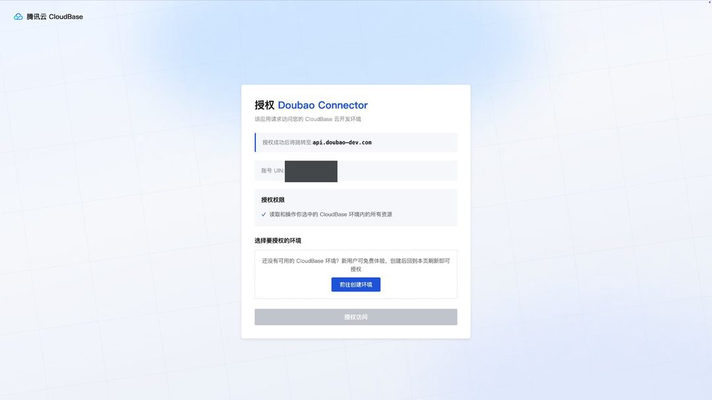

import IDESelector from '../components/IDESelector';
import RelatedResources from '../components/RelatedResources';

# Doubao Setup Guide

[Doubao](https://www.doubao.com/) is ByteDance's AI assistant. Both the **desktop app** and the **web app** support the CloudBase plugin.

Once configured, you can operate CloudBase services directly from the Doubao chat.

**For example:**

- "Build a WeChat mini-program ordering system with CloudBase" - AI scaffolds the pages, creates the document database, writes cloud functions and guides you through preview
- "Build a booking system where users place orders and the admin changes status" - AI models it on CloudBase PostgreSQL, configures permissions and wires up both ends
- "Add phone-number sign-in to a web app" - AI enables the auth method and wires in the CloudBase SDK

No switching to the cloud console - everything can be done in Doubao with natural language.

## Prerequisites

<details>
<summary><strong>A Tencent Cloud account and a CloudBase environment</strong></summary>

**Doubao:** Desktop app or web app, both work. Keep it up to date.

**Tencent Cloud account:** Authorization reads the Tencent Cloud account you are signed in with. Make sure CloudBase is activated for that account.

**CloudBase environment:** See [Create an environment](../../../quick-start/create-env). New users on the domestic site can activate one for free.

</details>

---

<IDESelector defaultIDE="doubao" />

## Install from the plugin marketplace

Doubao ships a plugin marketplace, and CloudBase is listed in the **精选** (Featured) category:

1. Open Doubao and click **插件·技能·伙伴** (Plugins · Skills · Partners) in the left navigation
2. Switch to the **插件** (Plugins) tab at the top and pick the **精选** (Featured) category
3. Find the **腾讯云 CloudBase** card and complete the install from the button on its right
4. Click **管理** (Manage) in the top right and confirm the **腾讯云 CloudBase** switch is on





The plugin consists of **1 connector** (Tencent CloudBase) plus a skill of the same name.

> The web app ([doubao.com](https://www.doubao.com/)) exposes its plugin entry from the left navigation, and installs the same way.

## First-time authorization

On first use, Doubao redirects to the CloudBase authorization page:

1. The top of the page shows the UIN of the Tencent Cloud account currently signed in
2. The authorization scope reads "读取和操作您选中的 CloudBase 环境内的所有资源" (read and operate all resources in the CloudBase environment you select)
3. Pick the environment to authorize from the dropdown
4. Click **授权访问** (Authorize)

After authorization succeeds, the page redirects back to `api.doubao-dev.com`.



The whole flow never asks you for a SecretId or an API Key.

**If the account has no environment yet**, the authorization page asks you to create one first:



New users on the domestic site can activate a CloudBase environment for free. Once it is created, refresh the authorization page and the new environment becomes selectable.

### Switching environments

To move to a different environment, authorize again and pick another environment on the authorization page. No configuration changes are needed.

> **Note:** If you are building a WeChat Mini Program, choose **微信公众平台登录** (WeChat Official Account Platform login) when signing in to CloudBase.

## Verify the connection

After authorization, type this in the chat:

```
检查 CloudBase 工具是否可用
```

Or ask for something concrete:

```
帮我查一下当前 CloudBase 环境的状态
```

## FAQ

**Q: I cannot find 腾讯云 CloudBase in the Featured category.**
A: Search for `CloudBase` in the search box at the top of the plugin page. If it is still missing, update Doubao to the latest version.

**Q: The card does not show an Install button.**
A: That slot switches to a chat entry once the plugin is installed. To check the install state, open **管理** (Manage) in the top right and look at the switch.

**Q: No environment is selectable on the authorization page.**
A: The signed-in Tencent Cloud account has no CloudBase environment yet. Activate one for free from the link on the authorization page, then refresh it.

**Q: The tool count shows 0.**
A: See [FAQ](../faq#mcp-shows-0-tools).

More questions: [full FAQ](../faq)

<RelatedResources ideName="Doubao" ideDocUrl="https://www.doubao.com/" />
