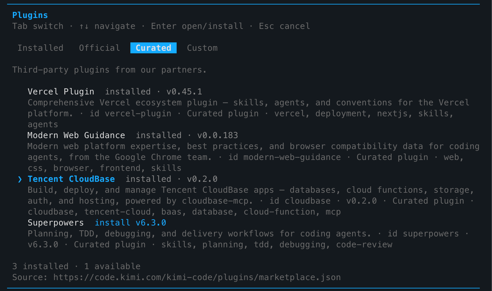
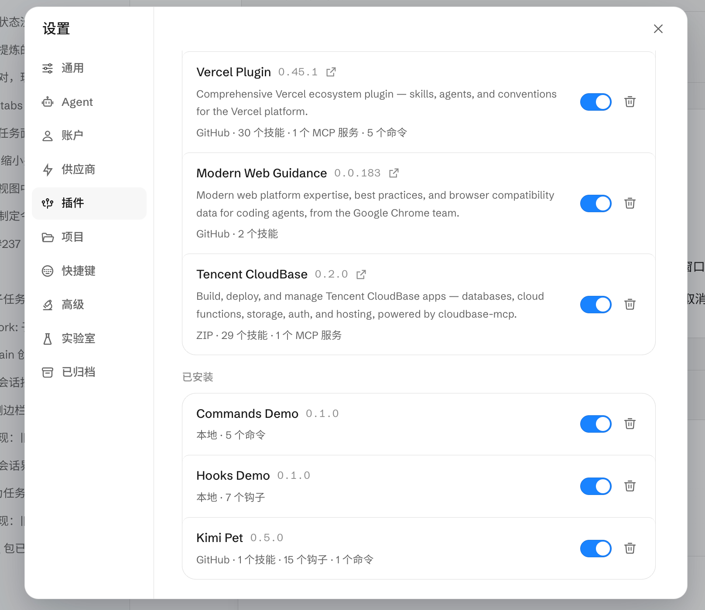

import IDESelector from '../components/IDESelector';
import RelatedResources from '../components/RelatedResources';

# Kimi Setup Guide

[Kimi](https://kimi.com/) is Moonshot AI's AI assistant lineup. Both **Kimi Code** (terminal CLI) and **Kimi Work** (desktop app) support the CloudBase plugin.

They share the same plugin (id: `cloudbase`) — only the install entry differs:

| Product | Form | Plugin entry | MCP config path |
| --- | --- | --- | --- |
| Kimi Code | Terminal CLI | `/plugins` → **Curated** | `~/.kimi-code/mcp.json` |
| Kimi Work | Desktop app | **Settings → Plugins** | Written by the plugin, no manual config |

Once configured, you can operate CloudBase services directly from the Kimi chat.

**For example:**

- "Build a WeChat mini-program ordering system with CloudBase" — AI scaffolds pages, creates the database, writes cloud functions, and guides you through preview
- "Build a booking system where users place orders and the admin changes status" — AI models it on CloudBase PostgreSQL, configures permissions, and wires up both ends
- "Add phone-number login to my web app" — AI enables the auth method and integrates the CloudBase SDK

No need to switch to the cloud console — everything happens in natural language inside Kimi.

## Prerequisites

<details>
<summary><strong>Node.js environment and a CloudBase environment</strong></summary>

**Version:** Kimi Code requires a build with plugin marketplace support (`/plugins` available); Kimi Work requires a build with the **Settings → Plugins** panel.

**Node.js:** Make sure Node.js v18.15.0 or higher is installed:

```bash
node --version
```

If not, download it from the [Node.js website](https://nodejs.org/en/download).

**CloudBase environment:** See [Create a CloudBase environment](../../../quick-start/create-env). New users on the domestic site can start for free.

</details>

---

<IDESelector defaultIDE="kimi-code" />

## Kimi Code (Terminal CLI)

### Install from the plugin marketplace (recommended)

Kimi Code ships a built-in plugin marketplace, and CloudBase is listed as a Curated plugin:

1. Type `/plugins` in Kimi Code to open the plugin panel
2. Switch to the **Curated** tab
3. Find **Tencent CloudBase** (id: `cloudbase`) and press Enter to select **install**
4. After install it shows `installed · v0.x.x`



> Marketplace source: `https://code.kimi.com/kimi-code/plugins/marketplace.json`

Restart Kimi Code or start a new session and CloudBase's 29+ skills and MCP tools load automatically.

### Configure MCP manually (optional)

For manual setup or debugging, edit Kimi Code's MCP config file `~/.kimi-code/mcp.json`:

```json
{
  "mcpServers": {
    "cloudbase": {
      "command": "npx",
      "args": ["-y", "@cloudbase/cloudbase-mcp@latest"],
      "env": {
        "INTEGRATION_IDE": "Kimi Code"
      }
    }
  }
}
```

## Kimi Work (Desktop App)

### Install from the plugin panel

Kimi Work has a built-in plugin manager with one-click enable:

1. Open Kimi Work and click **Settings** (gear icon) in the left sidebar
2. Open the **Plugins** panel
3. Find **Tencent CloudBase** and toggle it on
4. Once installed it shows the version and capability summary (e.g. `v0.2.0 · 29 skills · 1 MCP server`)



You can use the full CloudBase feature set in chat right after install.

### Install from a local ZIP (fallback)

If the plugin is not listed yet, install it from a local ZIP:

1. Download the latest `cloudbase-kimi-plugin.zip` from [CloudBase-MCP Releases](https://github.com/TencentCloudBase/CloudBase-MCP/releases)
2. In Kimi Work **Settings → Plugins**, choose **Install from local** (or drag the ZIP into the window)
3. Confirm the install and enable the plugin

## Verify the connection

In the chat, type:

```
Check whether the CloudBase tools are available
```

Or try a concrete task:

```
Show me the status of the current CloudBase environment
```

## FAQ

**Q: `/plugins` not found / no Plugins entry in Settings?**
A: Upgrade to the latest version — plugin support only shipped in recent builds.

**Q: Tencent CloudBase is not in the plugin list?**
A: In Kimi Code, try the **Official** or **Custom** tab; you can also use "Configure MCP manually" above. In Kimi Work, use the local ZIP install.

**Q: Nothing happens after toggling the plugin on?**
A: Restart the app. The first install may need to download dependencies — wait a few seconds and refresh.

**Q: MCP connection fails / skill count shows 0?**
A: Check that Node.js works locally and the network is reachable, then restart the app.

**Q: Tool count shows 0?**
A: See the [FAQ](../faq#mcp-tool-count-shows-0).

See the [full FAQ](../faq) for more.

<RelatedResources ideName="Kimi" ideDocUrl="https://kimi.com/" />
