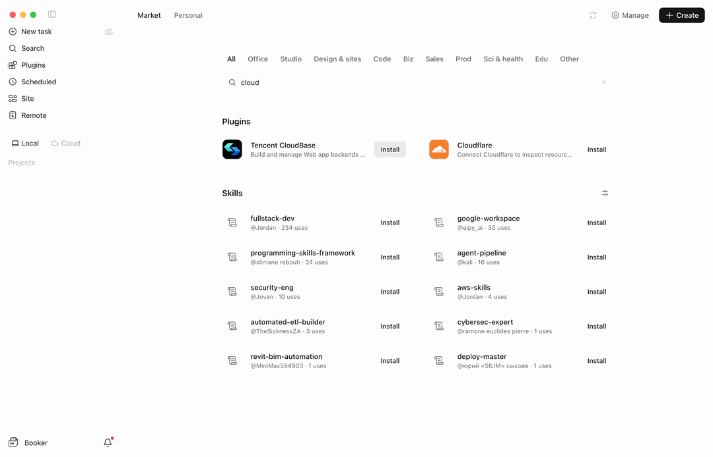

import IDESelector from '../components/IDESelector';
import RelatedResources from '../components/RelatedResources';

# MiniMax Code Setup Guide

[MiniMax Code](https://agent.minimax.io/) is MiniMax's AI coding product. Both the **desktop app** and the **terminal CLI** install CloudBase from the plugin marketplace.

They share the same plugin (id: `cloudbase`) - only the install entry differs:

| Form | Plugin entry | How to install |
| --- | --- | --- |
| MiniMax Code desktop app | **Plugins** → **Market** | Click **Install** in the market |
| MiniMax Code terminal CLI | `mcode plugin` | One command |

Once configured, you can operate CloudBase services directly from the MiniMax Code chat.

**For example:**

- "Build a WeChat mini-program ordering system with CloudBase" - AI scaffolds the pages, creates the document database, writes cloud functions and guides you through preview
- "Build a booking system where users place orders and the admin changes status" - AI models it on CloudBase PostgreSQL, configures permissions and wires up both ends
- "Add phone-number sign-in to a web app" - AI enables the auth method and wires in the CloudBase SDK

No switching to the cloud console - everything can be done in MiniMax Code with natural language.

## Prerequisites

<details>
<summary><strong>A CloudBase environment</strong></summary>

**MiniMax Code:** for the desktop app, use a version with the plugin marketplace (left navigation **Plugins** → **Market**); for the terminal CLI, use a version that ships the `mcode plugin` command.

**Node.js:** the plugin's MCP service is launched locally with `npx`, so make sure Node.js v18.15.0 or later is installed:

```bash
node --version
```

If it is missing, download it from [nodejs.org](https://nodejs.org/en/download).

**CloudBase environment:** See [Create an environment](../../../quick-start/create-env). New users on the domestic site can activate one for free.

</details>

---

<IDESelector defaultIDE="minimax-code" />

## MiniMax Code desktop app

1. Open the MiniMax Code desktop app and click **Plugins** in the left navigation
2. Switch to the **Market** tab at the top
3. Type `cloud` in the search box, or browse the list, to find the **Tencent CloudBase** card
4. Click **Install** on the right of the card



The Market page is split into a **Plugins** section and a **Skills** section. CloudBase lives in **Plugins**. Open the card to see what it contains: **1 MCP service** (`cloudbase-mcp`) and **31 skills**.

What you install is the official CloudBase plugin - the same plugin package that ships for other clients. It carries its own MCP service definition (`cloudbase-mcp`, launched locally by `npx @cloudbase/cloudbase-mcp@latest`) and registers it together with the skills. **You never write an MCP config by hand** - it works right after install.

> The Market UI is in English. Its category chips are All, Office, Studio, Design & sites, Code, Biz, Sales, Prod, Sci & health, Edu and Other.

Once installed, all CloudBase capabilities are available in the chat.

## MiniMax Code terminal CLI

The CLI uses the same plugin marketplace, and you can browse and install from the command line.

**Install the CLI**

```bash
curl -fsSL https://filecdn.minimax.chat/public/install.sh | bash
```

The installer bundles a private Node runtime, so no preinstalled Node.js is needed, and it does not use `sudo`. `mcode` lands in `~/.minimax-code/bin`, and the installer adds that directory to your shell PATH (takes effect in a new terminal).

**List the plugins available in the marketplace**

```bash
mcode plugin list -m official --available
```

**Install CloudBase**

```bash
mcode plugin add cloudbase@official
```

Afterwards, `mcode plugin list` shows what is installed, and `mcode plugin disable cloudbase` / `mcode plugin enable cloudbase` toggle it.

> The CLI and the desktop app share their configuration under `~/.minimax/`. There are two plugin sources: `official` (the official registry) and `local` (a directory at `~/.minimax/plugins`).

## Verify the connection

Type this in the chat:

```
检查 CloudBase 工具是否可用
```

Or ask for something concrete:

```
Look up the current state of my CloudBase environment
```

## FAQ

**Q: I cannot find Tencent CloudBase in the Market.**
A: Filter with `cloud` in the search box. If it is still missing, update MiniMax Code to the latest version that supports the Market.

**Q: `mcode` is not found in my terminal.**
A: The installer writes `~/.minimax-code/bin` into your shell config; open a new terminal. In the current one you can run `source ~/.zshrc`.

**Q: The plugin is installed but the tool count is 0.**
A: Check that Node.js is available on this machine and that the network connection is fine, then restart MiniMax Code and try again.

**Q: The tool count shows 0.**
A: See [FAQ](../faq#mcp-shows-0-tools).

More questions: [full FAQ](../faq)

<RelatedResources ideName="MiniMax Code" ideDocUrl="https://agent.minimax.io/" />
