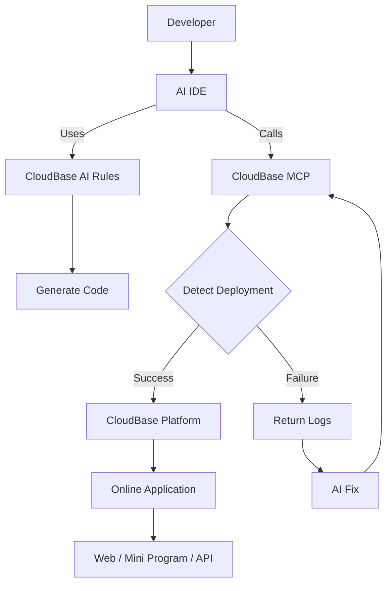

import IDEIconGrid from './components/IDEIconGrid';
import PromptScenarios from './components/PromptScenarios';
import TutorialsGrid from './components/TutorialsGrid';
import AIDevelopmentPrompt from './components/AIDevelopmentPrompt';


# AI-Native Development

Connect your AI development tools (such as OpenClaw, Cursor, CodeBuddy) with CloudBase for an AI-native development workflow.

**Fastest start:** Copy the AI Prompt below into your AI IDE. The agent will follow [`skill.md`](/skill.md).

```text
Help me get set up with CloudBase. Do the following:
1. Open https://docs.cloudbase.net/skill.md and follow the instructions.
2. When done, tell me you're ready and suggest the most relevant next steps.
```

**AI-native development means:**

- Describe requirements in natural language, and AI completes the full workflow from code generation to deployment
- Operate cloud services directly in chat: create databases, deploy cloud functions, configure static hosting—no manual console work
- Fix issues based on error logs, making development smoother

AI handles code generation and troubleshooting; CloudBase provides the runtime. Together, you can focus on business logic instead of infrastructure.

## Step 1: Connect CloudBase (plugin recommended)

Prefer the [one-click plugin](./ai-agent-plugins) (MCP + Skills + Hooks). You can also [configure MCP manually](./getting-started), or install [Skills only](./prompts/how-to-use). Full decision tree: [`skill.md`](/skill.md).

Select your AI development tool. **Click an icon below for the matching install guide.**

> Click the icons below to connect the corresponding tool

<IDEIconGrid />

## Step 2: Install CloudBase AI Skills as Needed (Optional)

If you already installed the plugin, you usually do not need Skills separately. Skills-only:

```bash
npx skills add tencentcloudbase/cloudbase-skills
```

You can also have the AI read [Setup Skill](https://docs.cloudbase.net/skill.md) to self-guide through the configuration.

See [How to Use Skills](./prompts/how-to-use) for details.

## Step 3: Start AI-Native Development

After setup is ready, choose a prompt to get started.

<AIDevelopmentPrompt />

<PromptScenarios />

## Core Capabilities

After connecting, your AI IDE gains these capabilities:

- **Database development**: create tables/collections and generate CRUD code
- **Cloud function development**: generate function code and deploy
- **Intelligent fixing**: analyze logs and generate patches
- **Domain knowledge**: built-in CloudBase, WeChat Mini Program, and other specialized knowledge bases

<div align="center">
  
</div>

## Video Tutorials

Want to learn CloudBase AI ToolKit through videos? See our tutorials and hands-on cases:

<TutorialsGrid />

## How It Works



## Open Source

[](https://github.com/TencentCloudBase/CloudBase-AI-ToolKit/stargazers)
[](https://cnb.cool/tencent/cloud/cloudbase/CloudBase-AI-ToolKit)

**Repositories:**

- **GitHub**: [https://github.com/TencentCloudBase/CloudBase-AI-ToolKit](https://github.com/TencentCloudBase/CloudBase-AI-ToolKit)
- **CNB**: [https://cnb.cool/tencent/cloud/cloudbase/CloudBase-AI-ToolKit](https://cnb.cool/tencent/cloud/cloudbase/CloudBase-AI-ToolKit)

## Community

### CloudBase AI Coding WeChat Group

<div align="center">

<br/>
<i>Scan to join the CloudBase AI Coding WeChat group</i>
</div>
