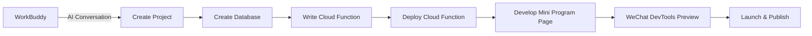

# Tutorial: Develop and Deploy a WeChat Mini Program with WorkBuddy

This tutorial will guide you through developing a "Daily Quotes" WeChat Mini Program from scratch and deploying it using WorkBuddy with CloudBase.

## Estimated Time

About 20 minutes

## Prerequisites

- [WorkBuddy](https://www.codebuddy.cn/docs/workbuddy) installed, with CloudBase enabled via the **Connect App** button or by typing `/cloudbase` (see the [configuration guide](../ide-setup/workbuddy))
- A [CloudBase environment](https://docs.cloudbase.net/quick-start/create-env) set up
- [WeChat Developer Tools](https://developers.weixin.qq.com/miniprogram/dev/devtools/download.html) installed and logged in

## Step 1: Enable CloudBase

Type `/cloudbase` in the WorkBuddy conversation, select the CloudBase Skill, and you're ready to go.

## Step 2: Create the Mini Program Project

Create a new directory in WorkBuddy and tell the AI:

```
Create a WeChat Mini Program project using cloud development that displays daily quotes
```

The AI will generate the project structure:

```
miniprogram-quotes/
├── app.js
├── app.json
├── app.wxss
├── pages/
│   └── index/
│       ├── index.js
│       ├── index.json
│       ├── index.wxml
│       └── index.wxss
├── cloudfunctions/
│   └── getQuote/
│       ├── index.js
│       └── package.json
├── project.config.json
└── README.md
```

## Step 2: Create a Database Collection

Continue typing in WorkBuddy:

```
Create a collection called "quotes" in the cloud environment to store daily quotes
```

## Step 3: Write a Cloud Function

Tell the AI:

```
Implement the following logic in the getQuote cloud function:
1. Randomly retrieve a quote from the quotes collection
2. If the collection is empty, return a default quote
3. Return the quote content and author information
```

## Step 4: Deploy the Cloud Function

Type in WorkBuddy:

```
Deploy the getQuote cloud function to the cloud environment
```

CloudBase will automatically upload and deploy the cloud function.

## Step 6: Call the Cloud Function in the Page

Continue typing:

```
In the index page, use wx.cloud.callFunction to call the getQuote cloud function and display the returned quote on the page
```

## Step 6: Preview with WeChat Developer Tools

Open the project root directory with WeChat Developer Tools:

```bash
# macOS
/Applications/wechatwebdevtools.app/Contents/MacOS/cli open --project "/path/to/miniprogram-quotes"

# Windows
"C:\Program Files (x86)\Tencent\微信web开发者工具\cli.bat" open --project "/path/to/miniprogram-quotes"
```

Preview the Mini Program in the developer tools and verify that quotes display and refresh correctly.

## Step 7: Add Management Features (Advanced)

To enrich the functionality, continue making requests in WorkBuddy:

```
1. Add a quote management page for adding, editing, and deleting quotes
2. Add category tags
3. Implement automatic daily quote rotation
```

## Full Workflow Review



## Next Steps

- Learn about the [Mini Program Development Skill](../prompts/miniprogram-development)
- Learn about the [Cloud Function Development Skill](../prompts/cloud-functions)
- Check out other [video tutorials](../tutorials)
